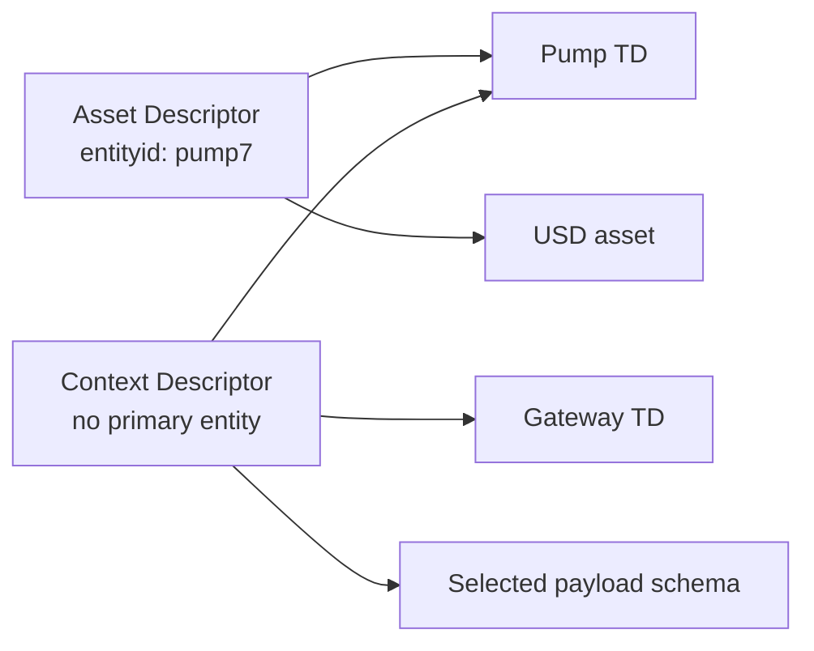

# Descriptor Registry - Design

<!-- words: describedby entityid entitytype messageref schemaref planurl -->
<!-- words: contexturl linkset uncached reserialization prebuilt -->
<!-- words: affordance descriptorid ETags matchversions namespace -->
<!-- words: opc ua OpenUSD TDs TMs USD workingdrafts -->

**Status:** Rationale for the [Descriptor Registry specification](../spec.md),
a working draft related to [xregistry/spec#792][issue792]. The specification
defines the domain contract; the coordinated [CloudEvents proposal][CE]
defines event linkage and its WoT/OPC UA profiles. This document explains
the selected design and its costs, not a second normative contract.

## 1. Problem

A Consumer can need a Message definition, payload schema, one or more WoT
TDs and an OpenUSD asset to interpret an event. Sending each URL in every
message repeats shared configuration. A device catalog has a related need:
describe one stable entity through several independently versioned
representations. An actor catalog can have metadata-only entries without
TDs. Neither catalog needs to pretend its entries are events.

The earlier draft modeled only Contexts and assigned generic `emitter` and
`target` roles. That made two TDs awkward and conflated listing a
representation with selecting its message role. The new model separates
entity description, representation inventory and profile-specific use.

## 2. Decision

One metadata-only Descriptor Resource contains typed attributes and named
References. A Reference has a class and retrieval URL, with OPTIONAL
projection-plan provenance for a resolved TD or TM. Names are local labels,
not reserved roles; several entries can have the same class.

Asset and Actor descriptions require identity and type; Context descriptions
need no fabricated primary entity. An agreed catalog/publication profile
selects those requirements. They can overlap without a `kind` discriminator:
a device description that supplies all inputs for an event can also be its
processing context.

Text equivalent: an Asset Descriptor names a pump TD and USD asset. A
Context Descriptor separately names the same TD, a gateway TD and a
payload schema. The Context is complete for its own use and does not
inherit the Asset's metadata.

## 3. Identity, Selection and Stability

`descriptorid` identifies a registry Resource; `entityid` identifies the
primary described entity. A connector URL, human-readable label or TD URL
is not interchangeable with that identity. Several Resources can describe
one entity for different audiences. Their access controls and References
remain independent; there is no automatic canonical choice.

`matchversions: true` enforces equality or common absence of `entityid`
across retained Versions. It cannot prevent changing a sole Version, all
Versions together or a URL after deletion. The Publisher's no-reassignment
rule supplies that historical obligation. `entitytype` can change in a new
Version when an entity is reclassified, without changing its identity.

Identity fields remain Core `uri` with explicit absolute-URI domain
constraints, allowing URNs without implying retrieval. A class is either a
bare name that matches `[a-z][a-z0-9_]*` as a whole string or an absolute URI
identifier with the same syntax. Generated schemas are not the authority for
those lexical and cross-field rules.

`messageref` and `schemaref` name exact References. Without a selector, a
unique candidate is selected, no candidate is absence, and multiple
candidates are ambiguous when selection is needed. Explicit invalid
selectors invalidate metadata even when an event supplies its own schema.
Neither map order nor Message type matching repairs that error.

After publication for use, References, selectors, entity descriptions and
processing-significant profile attributes stay stable. Publication to a
catalog counts as use even without events. Changes need new Versions;
Core bookkeeping follows Core. Pinning a Descriptor Version does not pin
Target bytes, so replay also needs suitable Target Versions and retention.

## 4. CloudEvents Without Unnecessary Links

The CE proposal uses Core `source` and `subject` when an agreed profile
gives them sufficient meaning. It adds OPTIONAL `describedby` for an
independently selected Processing Descriptor. An explicit link supplies
all needed Descriptor inputs not already in the event: it is not an
overlay merged with source or subject metadata.

Without that link, the agreed profile chooses source-Descriptor,
direct-subject or no-retrieval processing. There is no source-then-subject
probe based on URL appearance. Under the WoT profile, a direct TD URL plus
a fragment pointer can work without any Descriptor when the event/profile
already supplies the remaining inputs.

With an explicit Descriptor, the direct TD URL instead matches exactly one
named TD Reference. Duplicate or missing matches fail correlation; the
Consumer does not normalize, follow an alternate source or fetch the
subject independently to repair it. A named short subject disambiguates
duplicate URLs. CE owns the precise grammar and failure behavior.

The CE schema order is event `dataschema`, selected Descriptor schema,
then the selected Message's schema. Only absence advances precedence;
an unavailable or ambiguous selected schema does not authorize substitution.
The Message model already supplies schema information, so a separate schema
Reference is useful for independent pinning or direct bundle inclusion,
not mandatory duplication.

Event identity stays `source` plus `id`; descriptive entity identity does
not replace it. Changing a direct TD Version in `subject` changes subject
filtering, not the source-plus-ID namespace. A stable short subject with an
independently versioned `describedby` avoids that filtering coupling.

## 5. Retrieval and Publication

Ordinary GET returns metadata without `$details`. Consumers select and
retrieve only the Targets their profile needs. Core `inline` expands
contained entities, not URL-valued References.

If a Registry supports root POST and contains the relevant Group types,
one request can publish Targets and Descriptors together. Core checks the
write, not whether Reference URLs resolve. Across Registries, publish
Targets first, then the Descriptor, then release it for use. There is no
cross-registry transaction or permanent availability guarantee.

The OPTIONAL Descriptor bundle uses HTTP negotiation at the same URL.
Its `descriptor` member contains unchanged metadata; `documents` contains
each direct Target under its Reference name. Empty References produce
empty documents. A bundle retrieves every direct URL or returns an error;
ordinary JSON can be retried at the same URL to obtain only a needed subset.
That is a representation retry, not fallback to different context.

Generic Core does not assemble a bundle. A supporting deployment needs
custom resolution/serving behavior or a Publisher-built bundle served by
a suitably configured static endpoint. Both follow the same authorization,
completeness, freshness and Version-selection requirements. Static serving
is not inherently impossible; content negotiation alone does not implement
those requirements.

Targets can be fetched at different times. Only direct `url` values are
collected, not `planurl`, identity/class URIs or transitive dependencies.
JSON embedding can change bytes through reserialization; base64 can retain
the decoded Target bytes. Neither representation creates a digest scheme.
Per-target authorization, outbound policy, limits, caller isolation,
combined freshness, `Vary: Accept` and whole-representation ETags remain
necessary. A prebuilt file does not remove those obligations.

## 6. Relationship to Federation, Publication and WoT

The drafts in [xregistry/spec#571][issue571] address different layers.
Their links below pin the inspected revision, not a released contract.

| Draft | Responsibility | Descriptor boundary |
| --- | --- | --- |
| [Federation][federation] | Select sources and compose a Registry view, including ownership and shadowing. | Descriptor References select explicit representations, not federation sources or resolution ownership. |
| [Publication][publication] | Capture bytes, publish manifests and retain selected state through channels and open contexts. | A Core Descriptor write is not channel promotion; a bundle is not a manifest or atomic snapshot. |
| [WoT registry][wot] | Store TDs/TMs and provide domain-specific resolution. | The selected `url` is an ordinary resolved representation; `planurl` records provenance rather than replacing that representation. |
| [CE WoT profile][CE] | Bind events to TDs and their subjects. | CE owns direct TD and Descriptor-relative subject processing. XR does not require a Descriptor for all WoT events. |

Equal names, entity IDs or a USD asset Reference do not establish an
affordance-to-prim mapping, coordinate transform or units conversion.
A profile that needs those relations supplies an explicit mapping.
References also do not supply publication checked records, closure
bindings or runtime admission. A publication-aware integration remains
separate work.

## 7. Alternatives and Trade-offs

| Alternative | Trade-off |
| --- | --- |
| Multiple direct links in one CE attribute | Removes indirection but needs link-list parsing and carries every URL on the wire. |
| One CE attribute per representation | Simple individual values, but wire metadata grows and every new representation needs a convention. |
| Message definition as the indirection point | Reuses an existing entity but requires extending its model and mixing shared event-type definitions with deployment descriptions. |
| Endpoint as the indirection point | Reuses channel metadata but makes device/actor descriptions depend on a channel model. |
| RFC 9264 Linkset | General-purpose link representation; adds a document format rather than using Core metadata directly. |
| Out-of-band configuration only | Avoids wire links but gives Consumers no agreed description-retrieval path. |
| Always require a Descriptor | Uniform lookup, but adds an unnecessary resource when a profile-defined direct TD subject or `dataschema` already supplies everything. |

The selected design adds an uncached metadata request and a publication/
retention obligation. In return, catalogs and processing profiles share one
shape, wire linkage can remain small, and unrelated description Versions
can evolve independently. Bundles reduce client round trips but add serving
complexity and collect even Targets that an individual Consumer does not
need.

### 7.1. Descriptor Document Alternative

[Review of the earlier draft][document review] proposed storing all Target
content as the Resource document, with Reference metadata under `$details`.

| Benefit | Cost |
| --- | --- |
| Core can serve a prebuilt document without Target retrieval. | Metadata-only Consumers need the separate view; switching views by adding/removing `$details` would derive a URL from the selected link. |
| One document can contain all Targets. | Every Version duplicates content; Core does not check that document contents agree with References. |
| Content can be fixed alongside metadata. | A generated document reintroduces resolver access/freshness rules; a stored document changes only when republished. |

The draft retains metadata-only Resources and OPTIONAL negotiated bundles.
The [static-server feedback][static review] is addressed by making that
additional serving requirement explicit, while allowing prebuilt bundles
when all rules hold. This records the alternative rather than claiming
generic Core already performs collection.

## 8. Compatibility and Deferred Work

This redesign replaces Context collections, fixed Roles and `contexturl`.
It does not supply aliases or infer new classes from old roles. The CE
proposal owns migration of event attributes. Retained historical metadata
and events still need the contract under which they were published.

Descriptor Avro generation opts into nullable OPTIONAL fields with
`--avro-nullable-optionals`. The default generator path and four published
top-level Avro artifacts stay unchanged. Enabling it globally would change
what old non-null readers can accept; that broader compatibility change is
not part of this proposal. Focused regressions belong to the existing
generic generator tests, not a restored Context/domain test harness.

Reference digests, transitive packaging, universal type vocabularies,
same-Registry ID alternatives, lifecycle APIs and device execution remain
outside this draft. Extension classes use controlled absolute URI
identifiers without registration. The model allows an empty Reference map;
profiles, not a generic requirement flag, define the inputs they need.

[issue792]: https://github.com/xregistry/spec/issues/792
[issue571]: https://github.com/xregistry/spec/pull/571
[CE]: https://github.com/cloudevents/spec/pull/1406
[document review]: https://github.com/xregistry/spec/pull/796#discussion_r4540821623
[static review]: https://github.com/xregistry/spec/pull/796#discussion_r4551002837
[federation]: https://github.com/xregistry/spec/blob/2d072a03bc8647f1d07efddede571076e8cf6553/workingdrafts/federation/spec.md
[publication]: https://github.com/xregistry/spec/blob/2d072a03bc8647f1d07efddede571076e8cf6553/workingdrafts/publication/spec.md
[wot]: https://github.com/xregistry/spec/blob/2d072a03bc8647f1d07efddede571076e8cf6553/workingdrafts/models/wot/spec.md
