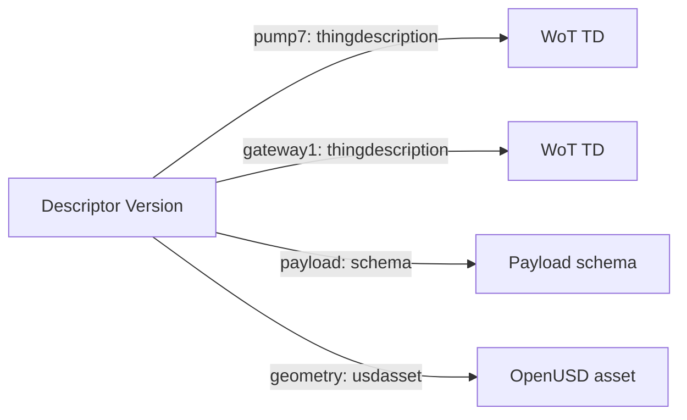

# Descriptor Registry Service - Version 1.0-rc4

<!-- words: descriptorgroup descriptorgroups descriptorgroupid -->
<!-- words: descriptorgroupsurl descriptorgroupscount descriptorid -->
<!-- words: descriptorsurl descriptorscount entityid entitytype -->
<!-- words: messageref schemaref planurl describedby baseurl allowlist -->
<!-- words: thingdescription thingmodel thingdescriptiongroups thingdescriptions -->
<!-- words: usdasset usdassetgroups OpenUSD reserializing -->
<!-- words: opcuapublisherid opcuadatasetwriterid opcuadatasetwritername -->
<!-- words: opcuadatasetname opcuametadatamajorversion opcuametadataminorversion -->
<!-- words: opcuamessagetype opcuasequence UInt16 DataSetMetaDataType -->
<!-- words: affordance descriptorurl keyframe matchversions namespace -->
<!-- words: NetworkMessage NodeSet opc ua prebuild prebuilt processData -->
<!-- words: PublisherId PumpProcessData servicekind TDs uncached usdassets -->
<!-- words: marcschier -->

## Abstract

This specification extends the xRegistry document format and API
[specification][xRegistry Core] with a Descriptor Registry. A Descriptor is
a metadata-only Resource that describes an entity or supplies shared
processing inputs. Its named References identify representations such as
Message definitions, schemas, WoT Thing Descriptions and OpenUSD assets.
Asset, Device, Actor and Context Descriptors use the same Resource shape.

This is a working draft related to [xregistry/spec#792][issue792].
Names and model details remain provisional. The coordinated
[CloudEvents proposal][CE proposal] defines event linkage; this specification
defines the Descriptor model, Reference selection and retrieval.

## Table of Contents

- [Descriptor Registry Service - Version 1.0-rc4](#descriptor-registry-service---version-10-rc4)
  - [Abstract](#abstract)
  - [Table of Contents](#table-of-contents)
  - [1. Overview](#1-overview)
    - [1.1. Descriptions and Processing Context](#11-descriptions-and-processing-context)
    - [1.2. Relationship to Other Specifications](#12-relationship-to-other-specifications)
  - [2. Notations and Terminology](#2-notations-and-terminology)
  - [3. Descriptor Registry Model](#3-descriptor-registry-model)
  - [4. Descriptor Registry](#4-descriptor-registry)
    - [4.1. Descriptor Groups](#41-descriptor-groups)
    - [4.2. Descriptor Resources](#42-descriptor-resources)
      - [4.2.1. `references` Attribute](#421-references-attribute)
      - [4.2.2. `entityid` Attribute](#422-entityid-attribute)
      - [4.2.3. `entitytype` Attribute](#423-entitytype-attribute)
      - [4.2.4. `messageref` and `schemaref` Attributes](#424-messageref-and-schemaref-attributes)
      - [4.2.5. Profile Attributes](#425-profile-attributes)
    - [4.3. References](#43-references)
      - [4.3.1. `class` Attribute](#431-class-attribute)
      - [4.3.2. `url` Attribute](#432-url-attribute)
      - [4.3.3. `planurl` Attribute](#433-planurl-attribute)
    - [4.4. Specializations](#44-specializations)
    - [4.5. Reference Selection](#45-reference-selection)
    - [4.6. Versions and Publication Stability](#46-versions-and-publication-stability)
  - [5. CloudEvents Integration (Informative)](#5-cloudevents-integration-informative)
    - [5.1. Selecting Processing Inputs](#51-selecting-processing-inputs)
    - [5.2. WoT and OPC UA](#52-wot-and-opc-ua)
  - [6. Examples](#6-examples)
    - [6.1. Asset and Actor Descriptions](#61-asset-and-actor-descriptions)
    - [6.2. Context Descriptor](#62-context-descriptor)
  - [7. Retrieval and Publication](#7-retrieval-and-publication)
    - [7.1. Ordinary Retrieval](#71-ordinary-retrieval)
    - [7.2. Publication Within One Registry](#72-publication-within-one-registry)
    - [7.3. Publication Across Registries](#73-publication-across-registries)
    - [7.4. Descriptor Bundle](#74-descriptor-bundle)
      - [7.4.1. Negotiation](#741-negotiation)
      - [7.4.2. Representation and Collection Boundary](#742-representation-and-collection-boundary)
      - [7.4.3. Authorization, Limits and Errors](#743-authorization-limits-and-errors)
      - [7.4.4. Caching and Consistency](#744-caching-and-consistency)
      - [7.4.5. Example](#745-example)
  - [8. Security](#8-security)

## 1. Overview

An asset catalog can describe the same device through a WoT Thing
Description and an OpenUSD asset. A software actor can have descriptive
metadata without either representation. A message-processing context can
combine a payload schema, two Things and native publisher metadata without
describing a single primary entity. A Descriptor Registry supports these
uses with one metadata-only Resource shape.

### 1.1. Descriptions and Processing Context

A Descriptor's `references` map gives each representation a local name,
`class` and absolute `url`. Names select entries; classes state what their
representations are. Neither assigns an event role. For example, a
Reference named `pump7` with class `thingdescription` identifies a TD, but
does not assert that the pump emitted an event.



Text equivalent: one Descriptor Version names two TDs, one schema and one
OpenUSD asset. These arrows are References, not containment or ownership.
Selection of a TD or schema is separate from listing those representations.

An ordinary `GET` returns all Descriptor metadata, including the References.
The Consumer retrieves only the representations its task needs. An
OPTIONAL [Descriptor bundle](#74-descriptor-bundle) can contain
every direct representation in one response. Bundle assembly requires
additional serving behavior; Core does not follow References.

### 1.2. Relationship to Other Specifications

Descriptors complement the [Message][xRegistry Message],
[Schema][xRegistry Schema] and [Endpoint][xRegistry Endpoint] registries and
the [WoT][WoT Draft] and [OpenUSD][OpenUSD Draft] working drafts. They
reference existing representations rather than extending those models.
A Registry MAY combine their Group types or serve Descriptors alone.

A Context Descriptor is not a federation context or a publication open
context. It does not select federation sources, promote a publication
channel or establish a snapshot. The [design comparison][draft boundaries]
explains the relationship to [xregistry/spec#571][issue571].

The [CloudEvents proposal][CE proposal] defines `describedby` and the WoT
and OPC UA event bindings. [Section 5](#5-cloudevents-integration-informative)
is informative: this specification does not redefine CloudEvents Core,
event-link selection, schema precedence or subject syntax. Descriptors are
also usable without CloudEvents.

This domain defines neither an entity ownership or lifecycle API nor a
registry or device execution service. A Reference to an action description
is not an invocation, authorization or statement of runtime readiness.

## 2. Notations and Terminology

The key words "MUST", "MUST NOT", "REQUIRED", "SHALL", "SHALL NOT", "SHOULD",
"SHOULD NOT", "RECOMMENDED", "MAY", and "OPTIONAL" in this document are to be
interpreted as described in [RFC 2119](https://tools.ietf.org/html/rfc2119).

For clarity, OPTIONAL attributes are OPTIONAL for clients to use.
Server-unknown extension attributes MUST be stored, subject to Core's
validation and resource limits. Specification-defined and server-known
attributes MUST generate an error when their feature is unsupported or
disabled. Core's write, omission and `null` rules continue to apply.

In pseudo-JSON snippets, `?` marks an OPTIONAL attribute, `*` permits zero or
more entries, and `#` starts an explanatory comment. Ellipses mark omitted
attributes, not literal JSON values.

| Term | Meaning |
| --- | --- |
| Descriptor | A metadata-only `descriptor` Resource. A Descriptor Version is one Version of that Resource. |
| Reference | One named entry of `references`. Its class describes the representation, not its message role. |
| Target | The representation identified by a Reference's `url`. |
| Profile | Agreed catalog, publication or processing rules that determine a specialization and its needed inputs. Descriptor contents alone do not establish that agreement. |
| Publisher | A client that publishes Descriptors and makes their Targets available. |
| Consumer | A client that reads Descriptors or uses their Targets. A Consumer need not process events. |
| Producer | A component that emits messages under an agreed profile. |
| Processing Descriptor | The Descriptor selected by a message binding as its shared processing inputs. It is a use of the same Resource shape, not a new Resource type. |
| Descriptor bundle | A negotiated read-only response containing a Descriptor and all of its direct Targets. |

## 3. Descriptor Registry Model

The authoritative extension model is [model.json](model.json).
`modelversion` is `0.1` while this remains a working draft. It versions the
Descriptor model independently of Core's `specversion`; no published
Descriptor compatibility URL is asserted.

The hierarchy is:

```text
Registry
  descriptorgroups/{descriptorgroupid}
    descriptors/{descriptorid}
      meta
      versions/{versionid}
```

The following serialization specimen omits common Core attributes other
than IDs and collection links. A Resource includes its default Version's
attributes; an explicitly addressed Version contains that Version's values.

```yaml
{
  "specversion": "<STRING>",
  "registryid": "<STRING>",
  "descriptorgroups": {
    "KEY": {
      "descriptorgroupid": "<STRING>",
      "descriptors": {
        "KEY": {
          "descriptorid": "<STRING>",
          "versionid": "<STRING>",
          "entityid": "<URI>", ?
          "entitytype": "<URI>", ?
          "messageref": "<STRING>", ?
          "schemaref": "<STRING>", ?
          "references": {
            "<STRING>": {
              "class": "<STRING>",
              "url": "<URL>",
              "planurl": "<URL>" ?
            } *
          },
          # Other Version attributes, including profile metadata, omitted
          "metaurl": "<URL>",
          "meta": { ... }, ?
          "versions": { ... }, ?
          "versionsurl": "<URL>",
          "versionscount": <UINTEGER>
        } *
      }, ?
      "descriptorsurl": "<URL>",
      "descriptorscount": <UINTEGER>
    } *
  }, ?
  "descriptorgroupsurl": "<URL>",
  "descriptorgroupscount": <UINTEGER>
}
```

The model declares `hasdocument: false`. Consequently, the Core document
attributes `descriptor`, `descriptorurl` and `descriptorbase64` do not occur.
An ordinary `GET` returns metadata without `$details`
([Core representations][HTTP representations]). The bundle is an
alternative response envelope at that same URL, not an attached document
or an attribute of this model.

Generated formats express structural constraints, not all domain rules.
In particular, identity URI syntax, class identifier syntax, selector
relations, applicable profile requirements and publication history need
domain validation. The model uses Core `uri` for identity, whose generated
format permits more than the absolute-URI values allowed below. Its
`class` attribute is a non-strict string and does not enforce the class
syntax in [Section 4.3.1](#431-class-attribute).

## 4. Descriptor Registry

Groups, Resources and Versions inherit their attributes and operations
from [Core][xRegistry Core]. Implementations MAY add extension attributes.
There is no `kind` discriminator or separate Asset or Actor collection.

### 4.1. Descriptor Groups

The Group Type name is `descriptorgroup`; its collection is
`descriptorgroups`. Every Descriptor MUST reside in a Descriptor Group.
Groups collect Descriptors in an application-defined way and have no
domain-specific attributes.

Group IDs such as `devices`, `actors` and `streams` are examples, not
standardized classifications. Consumers MUST NOT infer specialization,
entity type, authorization or message role from Group or Resource IDs.

### 4.2. Descriptor Resources

The Resource Type name is `descriptor`; its collection is `descriptors`.
It supports Core versioning, including an unlimited number of Versions
(`maxversions: 0`) and client-specified Version IDs (`setversionid: true`).
Implementations SHOULD use the default Core [Version ID][Core version-ids]
algorithm. A Resource URL selects the [default Version][Core defaults].

#### 4.2.1. `references` Attribute

- Type: Map of objects
- Description: Named References to representations associated with this
  Descriptor Version.

- Constraints:
  - REQUIRED. An empty map (`{}`) is valid.
  - A response MUST contain an object, not `null`, an array or a string.
    An absent OPTIONAL attribute is omitted. Write operations retain Core's
    omission and update rules; `{}` is not a model default.
  - Each key MUST follow the Core [map key rules][Core types]: one through
    63 lowercase alphanumeric characters, `:`, `-`, `_` or `.`, starting
    with an alphanumeric character. Keys are unique within the map.
  - Names are compared exactly and MUST NOT be interpreted as classes,
    source identities, destinations or permissions.
  - Multiple entries with the same class are permitted. A Consumer selects
    an entry through [Section 4.5](#45-reference-selection) or its profile,
    not map order.
  - An empty map does not supply any Target a profile requires.

- Examples:
  - `{}` for a metadata-only Actor description.
  - `{ "payload": { "class": "schema", "url": "https://schemas.example/pump-process-data/versions/3" } }`

#### 4.2.2. `entityid` Attribute

- Type: URI (`uri`)
- Description: Identity of the single primary entity this Descriptor
  describes. It is distinct from the Core `descriptorid`.

- Constraints:
  - OPTIONAL in the base model; REQUIRED for Asset and Actor
    specializations.
  - MUST be a non-empty RFC 3986 [absolute URI][absolute URI], with a
    scheme and no fragment. URNs are permitted; relative URI references
    and raw IRIs are not.
  - Comparison MUST be exact, without case folding or URI normalization.
    The value is an identifier, not an instruction to retrieve it.
  - Its presence and value MUST be the same across all Versions of a
    Descriptor Resource. The static scalar attribute has
    [`matchversions: true`][Core matchversions].
  - Changing or adding an entity association requires a new Resource.
    The Publisher MUST NOT repurpose a published Resource URL for another
    entity, including after deletion of older Versions or the Resource.
    Updating the only Version, or all retained Versions together, does not
    bypass this rule.
  - Multiple Resources MAY have the same `entityid`. Equality does not
    make their References, access policies or Versions interchangeable.

- Examples:
  - `urn:example:asset:pump7`
  - `urn:example:actor:planner7`

#### 4.2.3. `entitytype` Attribute

- Type: URI (`uri`)
- Description: Type of the primary entity, using an agreed vocabulary.

- Constraints:
  - OPTIONAL in the base model; REQUIRED for Asset and Actor
    specializations.
  - Requires a non-null `entityid`.
  - MUST meet the absolute-URI syntax and exact comparison requirements of
    `entityid`. It does not imply retrieval or authentication.
  - The catalog profile defines its accepted vocabulary and mapping.
    Unknown type URIs remain opaque identifiers, not inferred types.
  - Reclassification MAY change this value in a new Version without
    changing the entity association. Publication stability still applies.

- Examples:
  - `https://models.example/classes/device`
  - `https://models.example/classes/software-actor`

#### 4.2.4. `messageref` and `schemaref` Attributes

- Type: String
- Description: Exact local Reference name selecting a Message definition
  (`messageref`) or Descriptor-supplied payload schema (`schemaref`).

- Constraints:
  - Each attribute is OPTIONAL.
  - A present value MUST identify an existing Reference with the exact class
    `message` or `schema`, respectively.
  - Both explicit selectors MUST be validated as part of Descriptor
    validation, even if the Consumer's operation does not use them.
    A missing entry or wrong class is invalid metadata.
  - Absence invokes the candidate selection rules in
    [Section 4.5](#45-reference-selection); it is not a fixed default name.

- Examples:
  - `"messageref": "telemetry"`
  - `"schemaref": "payload"`

#### 4.2.5. Profile Attributes

Profiles MAY define additional typed Version attributes directly on the
Descriptor. They are not stored in an untyped metadata string map.
Deployed models SHOULD declare their types. Private names SHOULD have an
identifying prefix that follows Core attribute syntax, such as
`acme_servicekind`. URI-valued classes do not make URI-shaped attribute
names legal.

A profile defines presence, value comparison and conflicting-value
behavior. All processing-significant shared values follow
[Section 4.6](#46-versions-and-publication-stability). Values that vary
per message, such as a sequence number, are not shared Descriptor values.

### 4.3. References

Each Reference contains the following attributes. A class definition MAY
add attributes; Consumers ignore those they do not use unless their profile
requires them.

#### 4.3.1. `class` Attribute

- Type: String
- Description: Representation class of the Target.

- Constraints:
  - REQUIRED.
  - MUST use one of two disjoint lexical forms:
    - A bare class name MUST match the whole-string pattern
      `[a-z][a-z0-9_]*`: one lowercase ASCII letter followed by zero or more
      lowercase ASCII letters, digits or underscores.
    - Any other value MUST be a URI class identifier. It MUST meet the
      [absolute URI][absolute URI] syntax of `entityid`: non-empty, with a
      scheme and no fragment. URNs are permitted; relative URI references
      and raw IRIs are not.
  - A bare name contains no colon and an absolute URI requires one, so no
    value has both forms. A value that has neither form is malformed.
    Malformed values are invalid metadata, not unknown classes.
  - Class comparison is exact, without case folding or URI normalization.
  - Bare names are reserved for this specification. A Publisher defining a
    new class MUST use a URI class identifier in a namespace it controls.
    No central registration or class-URI retrieval is needed.
  - A class definition specifies accepted representations, additional
    attributes and interpretation. A change of meaning requires a new
    identifier.
  - Registries MAY store well-formed unknown URI classes. A Consumer MAY
    ignore an unsupported class unless its profile requires that Reference.
    A REQUIRED unsupported class makes the processing input unavailable.
  - Consumers MUST treat well-formed unknown bare names as unsupported;
    they MUST NOT guess their meaning. They are reserved for future
    standard classes. For example, `nodeset` is unsupported, whereas
    `NodeSet` and `node-set` are malformed.

| Standard class | Representation at `url` |
| --- | --- |
| `message` | xRegistry Message definition metadata. |
| `schema` | A schema in a format identified by the response and understood by the Consumer. |
| `thingdescription` | An ordinary resolved WoT TD, not xRegistry TD metadata or an unresolved projection plan. |
| `thingmodel` | An ordinary resolved WoT TM, not xRegistry TM metadata or an unresolved projection plan. |
| `usdasset` | An OpenUSD asset representation, not a live device-state feed. |

A class states what a representation is, not whether it is an emitter,
target, permission or universal processing requirement. There is no
requirement/description flag. A URI class can identify a NodeSet or a
mapping artifact without adding a generic message role.

Message Resources currently keep one Version ([Message model][Message model]).
A Message Reference can therefore follow a changing definition. A separate,
versioned schema Reference can select a schema independently or include it
in a bundle without following a link inside the Message definition.

#### 4.3.2. `url` Attribute

- Type: URL (`urlabsolute`)
- Description: Retrieval URL of the Target representation.

- Constraints:
  - REQUIRED. MUST be absolute and fragment-free.
  - Consumers and bundle servers MUST use the URL as given. They MUST NOT
    add `$details`, append query parameters, remove a Version segment or
    derive another representation URL.
  - The Publisher chooses the representation specified by the class:
    unsuffixed document URLs for TDs and schemas; metadata for Messages.
    A Target MAY be in any Registry or outside xRegistry.
  - SHOULD identify a Version when replay needs the same interpretation.
    A Version URL alone does not prove that Target bytes never change.

- Examples:
  - `https://registry.example/thingdescriptiongroups/factory/thingdescriptions/pump7/versions/3`

#### 4.3.3. `planurl` Attribute

- Type: URL (`urlabsolute`)
- Description: OPTIONAL provenance identifying the projection plan that
  produced the resolved representation at `url`.

- Constraints:
  - MAY occur only for `thingdescription` and `thingmodel` References.
  - MUST be absolute and fragment-free when present.
  - The Publisher MUST resolve and validate the representation before
    publishing it for use. `url` MUST identify the ordinary resolved TD or
    TM, not an unresolved plan.
  - A Consumer MUST NOT independently resolve the plan to replace the
    published representation. An unresolved plan returned at `url` is
    unusable as an ordinary TD or TM.
  - Absence or unavailability of this provenance does not invalidate an
    otherwise usable Target unless the agreed profile requires provenance
    checking. Such checks MUST apply the projection format's pairing rules.
    For the separate [WoT projection proposal][WoT projections], these
    include the shared `id`, scenario and result kind. Detected disagreement
    is invalid metadata, not permission to select a different Target.
  - A bundle MUST NOT retrieve this URL merely because it appears here.
    The plan's own manifest and resolution rules are not duplicated by
    this domain.

### 4.4. Specializations

An agreed catalog or publication profile selects the applicable
requirements. A Consumer MUST NOT infer a specialization from Group names,
Reference names, the presence of `entityid` or a TD Reference.

| Specialization | Requirements and scope |
| --- | --- |
| Asset Descriptor | Requires `entityid` and `entitytype` for one primary asset. The catalog authority defines the identity and type mapping; the record does not establish ownership. |
| Device Descriptor | An Asset Descriptor whose catalog profile identifies the primary asset as a device. Different References can describe its behavior and geometry. |
| Actor Descriptor | Requires `entityid` and `entitytype` for one actor. A software-only actor can have no TD and an empty `references` map. Descriptive identity is not authenticated caller identity. |
| Context Descriptor | No primary entity is REQUIRED. It supplies shared inputs for an agreed interpretation, potentially concerning several entities. All REQUIRED Descriptor inputs are supplied locally, not inherited from another Descriptor. |

These specializations can overlap. An Asset Descriptor that independently
supplies all inputs for a message profile can also serve as its Context
Descriptor. A multi-asset Context Descriptor need not fabricate a primary
entity to fit an asset catalog.

Catalogs use ordinary Core collections. An `entityid` lookup can return
multiple authorized descriptions; selection requires an explicit catalog
policy, not the first or most recently modified record. This specification
introduces neither a new search API nor a canonical Descriptor pointer.

### 4.5. Reference Selection

When a profile needs a Message definition or Descriptor-supplied schema, a
Consumer MUST use the following algorithm with the exact expected class
and its corresponding selector:

1. If the selector is present, require that it names an existing Reference
   of the expected class, then select that Reference.
2. Otherwise, collect the References with exactly that class.
3. One candidate selects that Reference; zero candidates means absence;
   more than one means ambiguity.

Invalid explicit selectors invalidate the Descriptor even when an event
has its own schema. Without a selector, multiple same-class entries are
valid inventory, but not an automatic selection. Ambiguity is distinct
from absence. A Consumer MUST NOT substitute map order, name conventions
or event-type matching for selection.

Profiles define selection for other classes and which inputs an operation
needs. Consumers retrieve only those inputs unless they request a bundle.
Failure to obtain a selected REQUIRED Target, an unsupported REQUIRED class
or ambiguous REQUIRED selection makes the operation's context unavailable.
Consumers MUST NOT claim successful interpretation or validation when its
prerequisites are missing and SHOULD record the condition. These outcomes
do not introduce new Core HTTP error codes.

### 4.6. Versions and Publication Stability

A Publisher MUST NOT change a Version's References, selectors, entity
description or processing-significant profile attributes after publication
for use. A semantic change requires a new Version. Publication for use
includes making an Asset or Actor description available to catalog readers;
it does not wait for a Producer to emit a URL. Core-controlled bookkeeping
continues to follow Core.

Core permits Version updates. `matchversions` compares retained Versions,
not immutable history, and Core's `immutable` model aspect is unavailable
for extension attributes. Publisher services and write permissions enforce
the publication rule, including the no-reassignment rule for `entityid`.
They need a record of published Versions or a stricter policy that never
changes Versions after creation. No new lifecycle attribute is introduced.

Consumers SHOULD select Version URLs when a reproducible interpretation
is needed. A Resource URL can select a new default Version; Consumers
SHOULD bound cache freshness for such representations. Publishers SHOULD
retain Descriptors and REQUIRED Targets for their intended processing and
replay period. A deleted historical Version is unavailable, not permission
to silently use current metadata.

To signal every relevant description change through a new Descriptor URL,
the Publisher pins Target Versions and creates a new Descriptor Version
when its References or shared inputs change. This does not freeze Target
bytes, close transitive dependencies or establish a cross-registry snapshot.

## 5. CloudEvents Integration (Informative)

The coordinated [CloudEvents proposal][CE proposal] owns the normative
event contract. This section explains how it uses this domain. An event
link selects a Descriptor; it does not make `entityid` the event's source
or authenticate any of its descriptions.

### 5.1. Selecting Processing Inputs

Event-format decoding precedes presence selection. In the CE JSON format,
`"describedby": null` is unset, so the profile's absent-link route applies.
An empty string or malformed set URL is invalid, not absent.

The OPTIONAL `describedby` attribute (`ce-describedby` in HTTP binary mode)
selects one Processing Descriptor at its unchanged URL. An explicit
selection supplies complete profile-required Descriptor inputs not already
in the event. It is not merged with source or subject metadata and is not
replaced when retrieval or selection fails.

Without `describedby`, an agreed profile can select a Descriptor through
`source`, a direct description through `subject`, or no retrieval at all.
There is no universal source-then-subject probe or inference from a
URL-looking string. An explicit retry of ordinary JSON at the same
Descriptor URL after bundle failure changes the representation, not the
selected context.

The CE binding applies payload schema precedence: event `dataschema`,
selected Descriptor schema, then the selected Message definition's schema.
Only absence advances to the next source. Invalid explicit selectors,
ambiguity or failure of the selected schema do not select a different
schema. Without a Descriptor, the last two candidates do not exist.
The schema describes the actual payload, including any protocol envelope;
a TD's affordance schema is not automatically that payload schema.

Core event identity remains `source` plus `id`. Changing `describedby`
does not change it. Changing source query parameters does; Consumers
do not remove them to make a Registry request work. A changed `subject`
can change subscription matching without changing the event-identity scope.

### 5.2. WoT and OPC UA

The proposed WoT profile supports both Descriptor-relative and direct TD
subjects. These examples illustrate its syntax, rather than defining a
second grammar:

| Subject | Processing under the WoT profile |
| --- | --- |
| `#` | The whole Thing from the unique TD Reference in the selected Descriptor. |
| `#/properties/processData` | An affordance in that unique TD. |
| `pump7#/properties/processData` | An affordance in the named `pump7` TD Reference. |
| `https://example.com/td/pump7/versions/3#/properties/processData` | A direct ordinary TD URL plus an affordance pointer. |

In the direct form without `describedby`, the event and profile supply
the remaining inputs; no Descriptor or source lookup is inherently needed.
With `describedby`, the fragment-free prefix matches exactly one
`thingdescription` Reference URL. Missing or duplicate matches fail
correlation, without URL normalization or independent TD retrieval to
bypass the Descriptor. A named relative subject disambiguates duplicate
URLs. Fragments are interpreted locally, never sent to HTTP servers.

The CE profile recognizes direct candidates by a case-insensitive
`http://` or `https://` prefix, then validates the URL. `http:pump7` is a
legal Reference name, not a direct URL. The whole-Thing direct form ends
in `#`. JSON Pointer and URI-fragment decoding are specified by CE.

The proposed OPC UA binding defines typed shared values, including
`opcuapublisherid`, `opcuadatasetwriterid`, `opcuadatasetwritername`,
`opcuadatasetname` and native metadata versions. `opcuadatasetname` means
`DataSetMetaDataType.Name`, not the writer name or a unique writer identity.
The following fragment can be added to the Descriptor Resource's model
attributes in an OPC UA deployment; it is not part of the generic base
model:

```json
{
  "opcuapublisherid": { "name": "opcuapublisherid", "type": "string" },
  "opcuadatasetwriterid": { "name": "opcuadatasetwriterid", "type": "integer" },
  "opcuadatasetwritername": { "name": "opcuadatasetwritername", "type": "string" },
  "opcuadatasetname": { "name": "opcuadatasetname", "type": "string" },
  "opcuametadatamajorversion": { "name": "opcuametadatamajorversion", "type": "integer" },
  "opcuametadataminorversion": { "name": "opcuametadataminorversion", "type": "integer" }
}
```

When Descriptor values satisfy native identity or metadata requirements,
the CE binding requires selection of a Descriptor Version, whether through
`describedby` or source. Duplicate values agree under its native decoding
rules. Direct TD retrieval does not supply missing native identities.
Sequence, status, time and native message type stay per event or in the
retained protocol envelope, not in shared Descriptor metadata. The binding
owns `opcuasequence` and `opcuamessagetype`; no additional CE headers are
introduced by the model fragment.

## 6. Examples

The [sample](samples/descriptor.json) is a Core create/update input, not a
complete GET response. Its three Groups organize an Asset, an Actor and a
Context Descriptor. Group and type URIs use illustrative deployment
vocabularies. The `.example` addresses are fixtures, not deployed services.

### 6.1. Asset and Actor Descriptions

Asset Descriptor `pump7` describes `urn:example:asset:pump7` through a TD
and an OpenUSD asset. These are representations of different aspects of
one device; their names do not establish a coordinate or affordance mapping.
An additional maintenance Descriptor can have the same `entityid` and
different References. A changed connector address or TD revision does not
by itself change the asset identity.

Actor Descriptor `planner7` has `entityid`, `entitytype`,
`acme_servicekind` and `"references": {}`. It is valid without a TD. If the
actor reports a device-change intent, its source identity remains the actor's;
a separate Context Descriptor can describe the affected device and intent
payload. Descriptive linkage does not authorize or execute that intent.

### 6.2. Context Descriptor

The `pump7-telemetry` Descriptor has no primary entity. It combines the
pump and gateway TDs, a selected payload schema, an OpenUSD asset and
typed shared OPC UA metadata. It does not inherit anything from `pump7`.
The following body is the Version create/update input; Core fills in
response bookkeeping:

```json
{
  "descriptorid": "pump7-telemetry",
  "versionid": "1",
  "schemaref": "payload",
  "references": {
    "pump7": {
      "class": "thingdescription",
      "url": "https://registry.example/thingdescriptiongroups/factory/thingdescriptions/pump7/versions/3",
      "planurl": "https://registry.example/thingdescriptiongroups/factory/thingdescriptions/pump7-plan/versions/3"
    },
    "gateway1": {
      "class": "thingdescription",
      "url": "https://registry.example/thingdescriptiongroups/factory/thingdescriptions/gateway1/versions/1"
    },
    "payload": {
      "class": "schema",
      "url": "https://schemas.example/pump-process-data/versions/3"
    },
    "geometry": {
      "class": "usdasset",
      "url": "https://assets.example/usdassetgroups/line1/usdassets/pump7/versions/2"
    }
  },
  "opcuapublisherid": "UInt16:12",
  "opcuadatasetwriterid": 17,
  "opcuadatasetwritername": "pump7-process",
  "opcuadatasetname": "PumpProcessData"
}
```

Under the coordinated CE WoT/OPC UA profile, a binary-mode event is:

```http
POST /events HTTP/1.1
Host: consumer.example
Content-Type: application/json
ce-specversion: 1.0
ce-id: sample-4711
ce-source: https://registry.example/descriptorgroups/devices/descriptors/pump7
ce-type: com.example.models.tm.pump.properties.processData.v1
ce-subject: pump7#/properties/processData
ce-describedby: https://registry.example/descriptorgroups/streams/descriptors/pump7-telemetry/versions/1
ce-opcuamessagetype: ua-keyframe
ce-opcuasequence: 17

{"Speed":1500,"Pressure":4.5}
```

The payload is a property value, not a retained NetworkMessage. `pump7`
selects one of the two TDs. `schemaref` selects the payload schema; the
PublisherId and writer metadata come from the Descriptor Version.
Retrieving source is unnecessary even though its URL names an Asset
Descriptor. Omitting the explicit link would not let that Asset Descriptor
invent the stream's missing native metadata.

The direct-TD alternative and its identity/filtering consequences are
specified and illustrated in the [CE proposal][CE proposal]. A Descriptor
is not needed merely because a WoT event needs its TD or an external
payload schema.

## 7. Retrieval and Publication

### 7.1. Ordinary Retrieval

A Consumer requests a Descriptor at the selected Resource or Version URL
without modification:

```http
GET /descriptorgroups/streams/descriptors/pump7-telemetry/versions/1 HTTP/1.1
Host: registry.example
Accept: application/json
```

The Consumer MUST check response status, media type, Descriptor shape and
explicit selectors before using it. It applies the agreed profile to
determine the Targets needed and uses their URLs unchanged, subject to
retrieval policy. It MUST NOT guess a Target's type from path spelling or
derive a metadata URL to inspect it. A media type alone does not prove
that a representation satisfies its class.

| Cache state and representation | Client requests |
| --- | --- |
| Descriptor and needed Targets cached | None. |
| Descriptor cached; N needed Targets uncached | N, potentially concurrent. |
| Nothing cached; ordinary Descriptor | One for the Descriptor, then N. |
| Nothing cached; complete bundle returned | One for the Descriptor and every direct Target. |

Caches use the exact request URL, representation and authorization context
and honor HTTP freshness and validation. Core's [`inline`][Core inline]
expands contained entities, not URL-valued References. Dependencies inside
Targets can require more retrievals in either representation.

### 7.2. Publication Within One Registry

If a Registry supports [`POST /`][HTTP root POST] and contains all involved
Group types, one request can publish Descriptors and Targets together.
Core's [write processing][HTTP processing] rejects the entire request when
any part fails. It does not validate whether URL-valued References resolve;
the Publisher checks availability before publication for use.

This schematic request omits Message attributes for brevity and assumes
support for `inline`. The response can include Descriptor Version metadata:

```yaml
POST /?inline=descriptorgroups.descriptors
Content-Type: application/json

{
  "messagegroups": {
    "factory": {
      "messages": {
        "com.example.telemetry.v1": { ... }
      }
    }
  },
  "descriptorgroups": {
    "streams": {
      "descriptors": {
        "telemetry": {
          "messageref": "definition",
          "references": {
            "definition": {
              "class": "message",
              "url": "https://registry.example/messagegroups/factory/messages/com.example.telemetry.v1"
            }
          }
        }
      }
    }
  }
}
```

Without `inline` support, the write is still one request; a subsequent GET
obtains the Version metadata. Referencing a Message does not freeze the
Message or recursively publish its schema.

### 7.3. Publication Across Registries

No transaction spans Registries. The Publisher makes Targets available,
publishes the Descriptor, verifies its REQUIRED inputs, and then releases
the description to catalog readers or configures Producers with its URL.
It MUST NOT publish for use a Descriptor whose REQUIRED Targets were not
made available. Failure stops that sequence; later Target deletion can
still make an earlier Descriptor unusable.

For profiles tied to an applied runtime generation, publication follows
the profile's application rule, not merely approval of a desired
configuration. The Descriptor itself is not evidence that application
succeeded.

### 7.4. Descriptor Bundle

The bundle is OPTIONAL for servers and Consumers. A generic Core server
returns metadata and does not assemble Targets. Supporting this feature
requires additional resolver/serving behavior. A Publisher can prebuild a
bundle and a suitably configured static endpoint can serve it if the same
completeness, Version selection, access and freshness rules hold.

The bundle is a response at the existing Descriptor URL, not a new API
path, model attribute, write operation or Resource document.

#### 7.4.1. Negotiation

The provisional, unregistered media type is
`application/vnd.xregistry.descriptor-bundle+json`. A Consumer requests it
at the unchanged Descriptor URL, optionally permitting ordinary JSON:

```http
Accept: application/vnd.xregistry.descriptor-bundle+json, application/json;q=0.5
```

- A supporting server MUST select the bundle when explicitly requested
  and preferred over ordinary JSON. A complete response uses `200 OK`
  and `Content-Type: application/vnd.xregistry.descriptor-bundle+json`.
  Conditional requests follow [Section 7.4.4](#744-caching-and-consistency).
- Without an explicit bundle request, the server MUST retain ordinary
  JSON behavior. An absent `Accept` or `*/*` alone does not request a bundle.
- Offering JSON permits a server without bundle support to return metadata
  in the same round trip. Consumers MUST distinguish responses by media
  type; requesting a bundle does not guarantee receiving one.
- A Consumer MAY omit the JSON alternative. A server implementing this
  negotiation MUST return `406 Not Acceptable` if it cannot offer an
  acceptable representation. A Consumer MUST reject an unexpected
  representation even when an older server ignores `Accept`.
- Once the server selects the bundle, Target retrieval or authorization
  failure MUST produce an error, not an ordinary JSON response concealing
  the failure.

A Consumer MAY explicitly retry ordinary JSON at the same Descriptor URL
after bundle failure and retrieve only the Targets it needs. This is a
representation retry, not a switch to a source, subject or another
Descriptor. No capability discovery request is needed.

#### 7.4.2. Representation and Collection Boundary

The JSON response has two REQUIRED members:

| Member | Type | Meaning |
| --- | --- | --- |
| `descriptor` | Object | The selected Descriptor metadata, unchanged. |
| `documents` | Map of objects | Exactly one entry per name in `descriptor.references`. |

An empty `references` map produces an empty `documents` map. Each entry has:

| Member | Presence | Meaning |
| --- | --- | --- |
| `url` | REQUIRED | The exact URL of the corresponding Reference. |
| `contenttype` | REQUIRED | The Target's media type with relevant parameters; `application/octet-stream` if none was supplied. |
| `content` | Conditional | The Target as a JSON value. |
| `contentbase64` | Conditional | The Target bytes as a base64 string. |
| `baseurl` | Conditional | The final retrieval URL; REQUIRED when an allowed redirect changed it, otherwise omitted. |

Exactly one of `content` and `contentbase64` MUST be present. Following
Core's [document embedding pattern][Core document encoding], valid JSON can
be embedded as a value; other content, including non-JSON text, MUST use
base64. A server MAY also use base64 to preserve exact JSON bytes.
Consumers MUST support both forms and MUST NOT assume reserializing
`content` reproduces original bytes.

HTTP content codings MUST be decoded before embedding. An empty Target is
`"contentbase64": ""`; a JSON null Target is `"content": null`, not an
xRegistry update instruction. These members belong to the response
envelope, not to Descriptor metadata.

The server captures one Descriptor representation and obtains each direct
`references.*.url`:

- Authorized local content and valid cache entries MAY replace network
  requests.
- Network requests use the exact URL with `Accept: */*`, not the bundle
  negotiation header. The server MUST NOT rewrite values inside Targets.
- One retrieval MAY supply multiple names with the same URL. The result
  still has every name and its exact corresponding `url`.
- The server MUST return every complete direct representation or an error.
  No omitted, truncated or unauthorized entry is a successful bundle.
- The server MUST NOT automatically retrieve `planurl`, `entityid`,
  `entitytype`, class URIs or links inside Targets. A provenance document
  can be included only if independently listed as an ordinary named
  Reference with an appropriate class.

Thus, a Message's inline schema is already included with its metadata,
but a separately linked schema is not. To include it, a Publisher adds a
direct `schema` Reference. Schema imports, TD dependencies and OpenUSD
sublayers or textures do not cause recursive collection. An event's
`dataschema` is not an input to the bundle request.

Relative dependencies use a Target's `baseurl`, or `url` when unchanged,
subject to the format's own base rules. They never use the Descriptor URL
as their base. A separately named source description does not imply
inheritance of its metadata.

#### 7.4.3. Authorization, Limits and Errors

Before including a Target, the server MUST establish that the caller is
authorized to receive it. Read access to a Descriptor grants no access to
its Targets. Credentials for each origin or an explicit publication policy
can support the check, but possession of a service credential alone is not
evidence of caller authorization. The server MUST NOT blindly forward
caller credentials to Target origins.

The server MUST apply outbound request policy to each URL, resolved
network address and redirect destination, including protection against
disallowed local and internal services. Unsupported schemes or origins
MUST be rejected rather than tried through an unrestricted proxy.

The server MUST bound Target count, retrieved and encoded bytes, retrieval
time, redirects and concurrency. Byte limits include decompression and
base64 expansion. These access and limit rules also apply to content held
locally, in a cache or in a prebuilt bundle.

Denied authorization, missing or unavailable Targets and exceeded limits
MUST return an error rather than a partial successful bundle. The server
MUST NOT substitute an empty body for missing or denied content.
Errors SHOULD use the [Core HTTP error format][HTTP errors] and distinguish
denied, unavailable and limit-exceeded conditions without disclosing
Target content or credentials.

#### 7.4.4. Caching and Consistency

Servers supporting bundles MUST send `Vary: Accept` on both representations,
preserving other REQUIRED `Vary` fields. Caches MUST honor
[HTTP caching rules][RFC9111], representation selection, authorization and
source cache restrictions. Caller-specific content MUST NOT be reused for
another caller without establishing authorization.

Bundle freshness MUST NOT exceed that permitted by the Descriptor and
every included Target. When the server cannot establish a combined cache
policy meeting those restrictions, it MUST send `Cache-Control: no-store`.
Extracted entries MUST NOT be treated as independently public or
longer-lived than the bundle that supplied them.

If supplied, an `ETag` MUST validate the whole selected representation,
not only the Descriptor's epoch or Version ID. Before sending
`304 Not Modified`, the server MUST establish that every included response
is still valid under its cache policy and that the resulting bundle is
unchanged.

Published Descriptor metadata is stable under
[Section 4.6](#46-versions-and-publication-stability), but Target bytes can
change independently and be retrieved at different times. A bundle MUST NOT
be described as an atomic snapshot merely because it arrived in one
response. It also establishes neither live readiness nor digest-verified
transitive closure.

#### 7.4.5. Example

The metadata-only `planner7` Actor from the sample needs no Target
retrieval. The following complete bundle illustrates the empty-map case.
OPTIONAL Core metadata is omitted; no Target or Reference is omitted.

```http
GET /descriptorgroups/actors/descriptors/planner7/versions/1 HTTP/1.1
Host: registry.example
Accept: application/vnd.xregistry.descriptor-bundle+json
```

Response headers:

```http
HTTP/1.1 200 OK
Content-Type: application/vnd.xregistry.descriptor-bundle+json
Vary: Accept
Cache-Control: no-store
```

```json
{
  "descriptor": {
    "descriptorid": "planner7",
    "versionid": "1",
    "self": "https://registry.example/descriptorgroups/actors/descriptors/planner7/versions/1",
    "xid": "/descriptorgroups/actors/descriptors/planner7/versions/1",
    "epoch": 1,
    "isdefault": true,
    "createdat": "2025-01-15T09:00:00Z",
    "modifiedat": "2025-01-15T09:00:00Z",
    "ancestorid": "1",
    "entityid": "urn:example:actor:planner7",
    "entitytype": "https://models.example/classes/software-actor",
    "references": {},
    "acme_servicekind": "maintenance-planner"
  },
  "documents": {}
}
```

A bundle for `pump7-telemetry` instead has entries `pump7`, `gateway1`,
`payload` and `geometry`. The TDs and schema can use `content`; non-JSON
OpenUSD bytes use `contentbase64`. The pump's `planurl` causes no fifth
retrieval. Unavailable geometry makes the entire bundle fail even when
the Consumer needs only the TD and schema; it can then explicitly retry
ordinary JSON and retrieve that subset.

## 8. Security

Like [Core][xRegistry Core], this specification does not select an
authentication or authorization mechanism. Deployments use mechanisms
suited to their trust boundaries.

- **URLs and metadata are untrusted input.** Consumers MUST apply
  retrieval policy before using Descriptor or Target URLs, including
  redirect destinations and resolved network addresses.
- **A Reference grants no access.** Credentials belong to configured
  origins and MUST NOT be forwarded indiscriminately.
- **Identity is a claim.** Equal entity IDs, a selected Descriptor, a TD
  action or an actor classification do not authenticate a source, authorize
  an operation or establish ownership.
- **Integrity depends on publication control.** Writers and Target origins
  can affect interpretation. A Version URL is not a signature or content
  digest; retention and write controls enforce publication stability.
- **A Descriptor exposes all of its metadata.** Access policy needs to
  account for sensitive Reference URLs, entity identities and profile
  attributes, even when the caller cannot retrieve their Targets.
- **Retrieval consumes resources.** Consumers SHOULD bound metadata size,
  request count, time and concurrency. Bundle servers additionally follow
  [Section 7.4.3](#743-authorization-limits-and-errors).
- **A bundle distributes content.** The Consumer still applies its class,
  format and content-trust checks. Bundling does not prove that a Target
  origin signed or authenticated the supplied bytes.

[issue792]: https://github.com/xregistry/spec/issues/792
[issue571]: https://github.com/xregistry/spec/pull/571
[draft boundaries]: design/design.md#6-relationship-to-federation-publication-and-wot
[CE proposal]: https://github.com/cloudevents/spec/pull/1406
[WoT projections]: https://github.com/marcschier/wot-thing-description/pull/1
[absolute URI]: https://www.rfc-editor.org/rfc/rfc3986.html#section-4.3
[Core types]: ../../../core/spec.md#data-types
[Core matchversions]: ../../../core/model.md#attributesstringmatchversions
[Core version-ids]: ../../../core/spec.md#version-ids
[Core defaults]: ../../../core/spec.md#default-version-of-a-resource
[Core inline]: ../../../core/spec.md#inline-flag
[Core document encoding]: ../../../core/spec.md#resource-attribute
[HTTP representations]: ../../../core/http.md#resource-metadata-vs-resource-document
[HTTP root POST]: ../../../core/http.md#post-
[HTTP processing]: ../../../core/http.md#creating-or-updating-entities
[HTTP errors]: ../../../core/http.md#error-processing
[Message model]: ../../../message/model.json
[WoT Draft]: ../wot/spec.md
[OpenUSD Draft]: ../openusd/spec.md
[RFC9111]: https://www.rfc-editor.org/rfc/rfc9111.html
[xRegistry Core]: https://xregistry.io/xreg/xregistryspecs/core-v1/docs/spec.html
[xRegistry Endpoint]: https://xregistry.io/xreg/xregistryspecs/endpoint-v1/docs/spec.html
[xRegistry Message]: https://xregistry.io/xreg/xregistryspecs/message-v1/docs/spec.html
[xRegistry Schema]: https://xregistry.io/xreg/xregistryspecs/schema-v1/docs/spec.html
